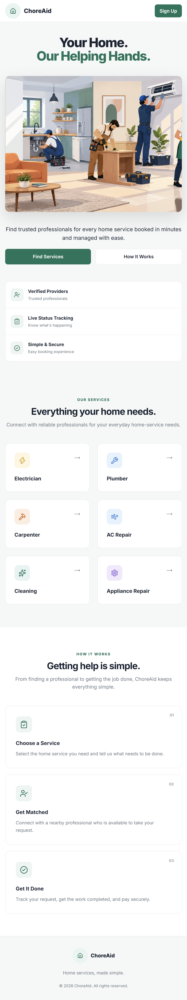
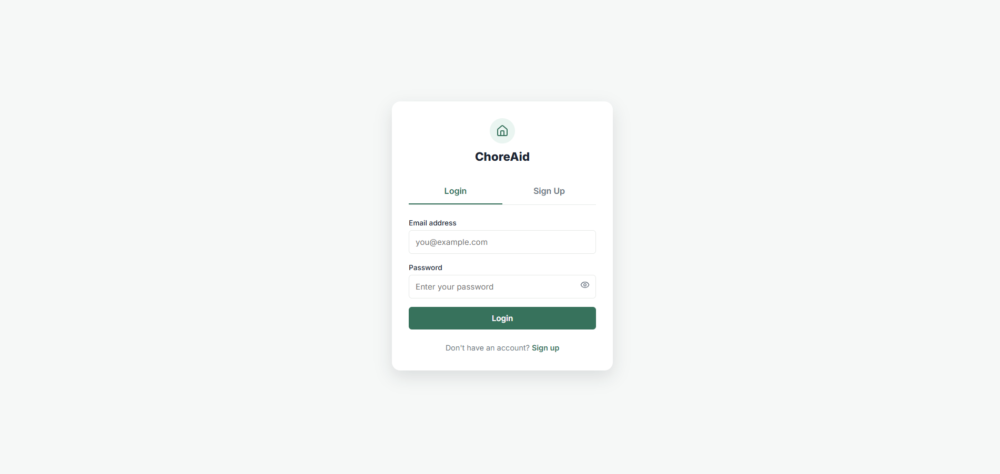
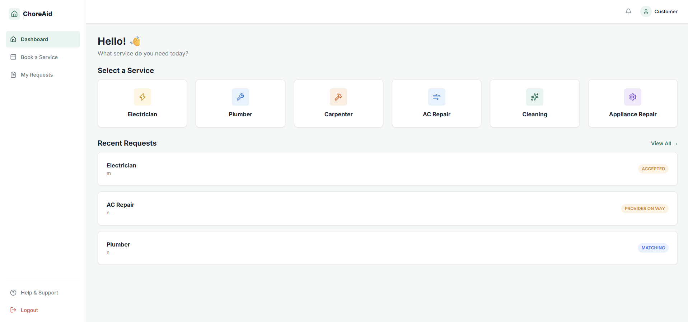
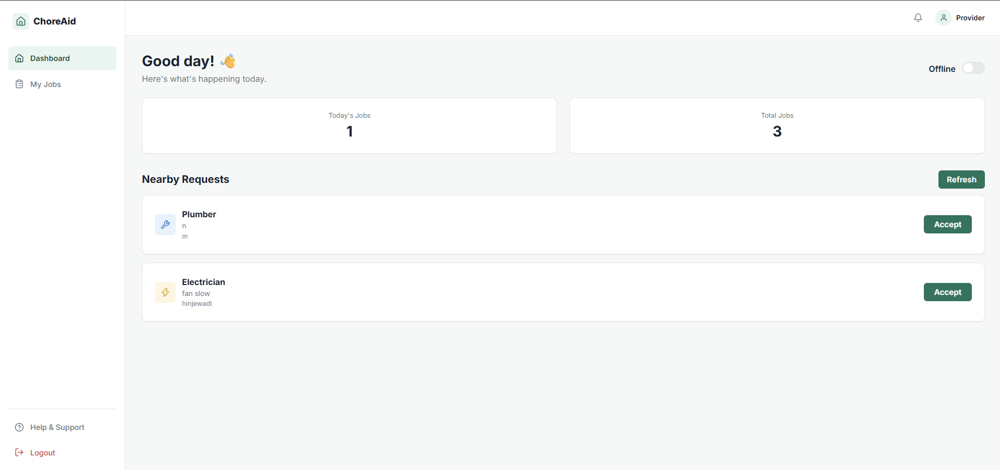
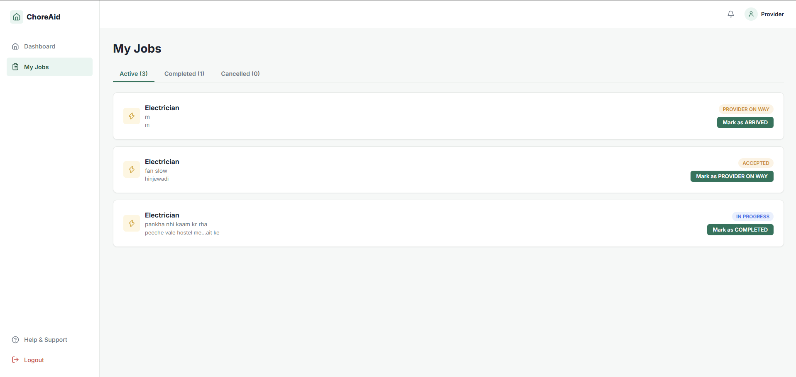

# ChoreAid

A full-stack home services marketplace that connects customers with nearby service providers such as electricians, plumbers, carpenters, and more. Customers post service requests, and providers who are online and nearby can view and accept them in real time.

**[Live Demo](https://choreaid-frontend.vercel.app)** | **[Backend API](https://choreaid.onrender.com)**

> **Note:** The backend runs on free hosting tiers. If the site has been idle, the first request (login, signup) can take 30-50 seconds while the server wakes up. Please wait a moment and try again.

---

## Demo Credentials

| Role | Email | Password |
|------|-------|----------|
| Customer | `Customer1@g.com` | `1234` |
| Provider | `Provider1@g.com` | `12344` |

You can also create a new account from the Sign Up page.

---

## Screenshots

### Home


### Customer Experience
| Login / Sign Up | Dashboard |
|-----------------|-----------|
|  |  |

### Provider Experience
| Provider Dashboard | My Jobs |
|--------------------|---------|
|  |  |

---

## Features

- **Role-based accounts:** separate customer and provider flows with secure signup and login
- **Service categories:** Electrician, Plumber, Carpenter, AC Repair, Cleaning, Appliance Repair
- **Service requests:** customers pick a category and create a request for a job
- **Nearby matching:** providers see requests close to them using geospatial queries
- **Online/offline toggle:** providers choose when they are available for new requests
- **Real-time updates:** live notifications and status changes with Socket.IO
- **Provider profiles:** providers set up and update their profile and service details
- **Job tracking:** providers manage accepted work from a My Jobs page
- **Protected routes:** JWT authentication on private API endpoints

---

## Tech Stack

**Frontend**
- React (Vite)
- JavaScript, HTML, CSS
- Lucide React icons
- Axios

**Backend**
- Node.js
- Express.js
- MongoDB with Mongoose (geospatial indexing)
- JWT authentication
- Socket.IO

**Tools and Deployment**
- Git and GitHub
- Postman for API testing
- Vercel (frontend)
- Render (backend)
- MongoDB Atlas (database)

---

## Project Structure

```
ChoreAid/
├── backend/
│   ├── src/
│   │   ├── controllers/
│   │   ├── middleware/
│   │   ├── models/
│   │   └── routes/
│   ├── app.js
│   ├── server.js
│   └── package.json
└── frontend/
    ├── src/
    │   ├── components/
    │   ├── pages/
    │   └── ...
    └── package.json
```

---

## Getting Started

### Prerequisites

- Node.js (v18 or later)
- A MongoDB database (a free MongoDB Atlas cluster works well)
- npm

### 1. Clone the repository

```bash
git clone https://github.com/Sssrii/ChoreAid.git
cd ChoreAid
```

### 2. Set up the backend

```bash
cd backend
npm install
```

Create a `.env` file in the `backend` folder:

```env
PORT=5000
MONGO_URI=your_mongodb_connection_string
JWT_SECRET=your_secret_key
```

Start the server:

```bash
node server.js
```

The API will run at `http://localhost:5000`.

### 3. Set up the frontend

```bash
cd ../frontend
npm install
```

Create a `.env` file in the `frontend` folder and point it to your backend:

```env
VITE_API_URL=http://localhost:5000/api
```

Start the app:

```bash
npm run dev
```

The app will run at `http://localhost:5173`.

### 4. Add service categories

A fresh database has no service categories. Add them once with Postman (or any API client):

```
POST http://localhost:5000/api/services
Body: { "name": "Electrician" }
```

Repeat for Plumber, Carpenter, AC Repair, Cleaning, and Appliance Repair.

---

## API Overview

| Method | Endpoint | Description | Auth |
|--------|----------|-------------|------|
| POST | `/api/auth/register` | Create a new account | No |
| POST | `/api/auth/login` | Log in and receive a JWT | No |
| GET | `/api/services` | List all service categories | No |
| POST | `/api/services` | Add a service category | Yes |
| GET | `/api/providers/profile` | Get the provider profile | Yes |
| PUT | `/api/providers/profile` | Create or update the provider profile | Yes |

---

## Deployment

| Part | Platform |
|------|----------|
| Frontend | Vercel |
| Backend | Render |
| Database | MongoDB Atlas |

Set `MONGO_URI` and `JWT_SECRET` as environment variables on Render, and `VITE_API_URL` on Vercel. In MongoDB Atlas, allow network access from `0.0.0.0/0` so Render can connect.

---

## What I Learned

- Building and deploying a full-stack app end to end
- Designing REST APIs and testing them with Postman
- Implementing JWT authentication and role-based access
- Using geospatial indexing to find nearby providers
- Adding real-time features with Socket.IO
- Debugging production issues such as environment variables, database connectivity, and case-sensitive file paths on Linux servers

---

## Future Improvements

- Payments integration
- Ratings and reviews for providers
- Earnings dashboard for providers
- Push notifications
- Booking schedule and calendar

---

## Author

**Sssrii**

- GitHub: [@Sssrii](https://github.com/Sssrii)
